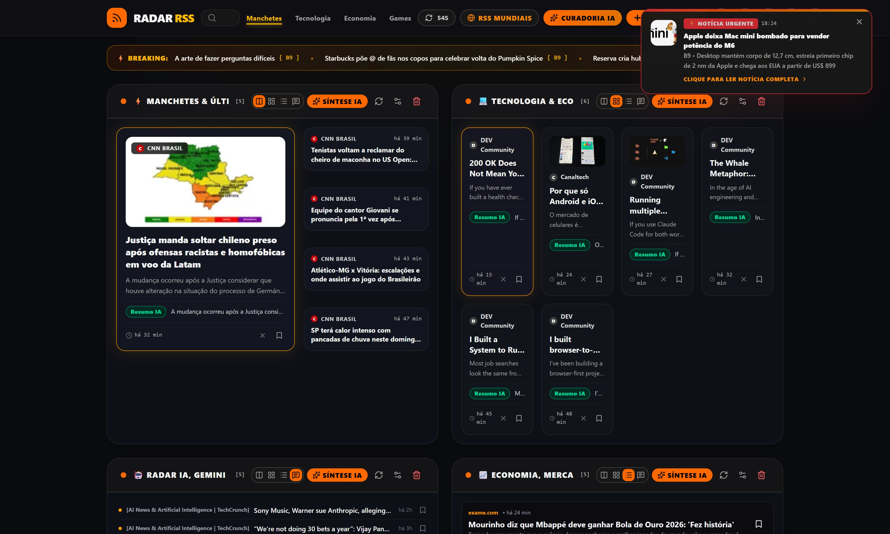

# 📡 Radar RSS

<div align="center">

[](https://github.com/dznass-cmd/RadarRSS/releases)
[](LICENSE)
[](https://react.dev)
[](https://www.typescriptlang.org)
[](https://www.electronjs.org)
[](https://github.com/dznass-cmd/RadarRSS/releases)
[](https://github.com/dznass-cmd/RadarRSS/releases)
[](https://github.com/dznass-cmd/RadarRSS/releases)
[](https://ai.google.dev)
[](https://tailwindcss.com)

<br />

**Real-time intelligent dynamic RSS news aggregator with Google Gemini AI curation, Windows and Linux desktop applications, and native Android app support.**

**English** • [Português (Brasil)](README.pt-BR.md)

<br />

[📥 Download App](#-download--installation-windows-linux--android) • [💡 Tips & Best Practices](#-tips--best-practices) • [🚀 What's New in v0.2.0](#-whats-new-in-v020) • [✨ Key Features](#-key-features) • [🚀 Getting Started](#-getting-started-locally) • [🤖 AI Configuration](#-ai-configuration-google-gemini) • [🔄 Auto-Updates](#-automatic-updates)

<br /><br />

<p align="center">
  
</p>

</div>

---

## 📖 About the Project

**Radar RSS** monitors multiple news portals and RSS feeds in real time, automatically organizing articles into modular, customizable category blocks (such as *Headlines*, *Technology*, *Finance & Business*, *World News*, *Gaming & Entertainment*, and custom topics).

Powered by **Google Gemini Artificial Intelligence**, Radar RSS synthesizes executive bullet-point summaries, extracts key takeaways, evaluates urgency for instant breaking news alerts, and translates foreign feeds on the fly — eliminating clutter and saving you hours of reading time.

---

## ✨ Key Features

- ⚡ **Real-Time Feed Aggregation:** High-throughput async ingestion of national and international RSS/Atom feeds with continuous background updates.
- 🧩 **Cross-Feed Story Clustering & Deduplication:**
  - Automatically identifies and consolidates identical news events reported across multiple outlets (e.g. Reuters, The Verge, TechCrunch) into a unified story cluster.
  - Multi-signal similarity engine: token overlap, n-grams, named entity/number matching, action divergence protection (preventing false merges like "announces new iPhone" vs "raises iPhone price"), temporal decay, and canonical URL normalization.
  - Multi-source UI badge ("3 fontes"), expandable coverage drawer, and interactive source switcher inside the reader.
  - Consolidated multi-source AI executive briefings synthesizing all reporting viewpoints into a unified briefing without duplicates.
  - User-configurable clustering strategies (Balanced, Conservative, Aggressive) and time windows in Settings.
- 🧠 **Smart AI Curation (Google Gemini):**
  - Instant executive bullet summaries per topic or article.
  - Contextual urgency evaluation with automatic **Breaking News** badges and sound alerts.
  - Multi-language translation and synthesis for global articles.
- 🖼️ **Smart Image Extraction (`SafeImage`):** Robust parsing for `media:content`, `media:thumbnail`, `enclosure`, and embedded HTML `` elements with relative URL normalization, tracker pixel filtering (1x1 blocking), and graceful visual fallback placeholders.
- 🖥️ **Windows and Linux Desktop App:** High-performance native Electron window with titlebar integration, keyboard shortcuts, and background tray support.
- 📱 **Native Android Mobile App:** Seamless touch experience built with Capacitor, featuring pull-to-refresh gestures, haptic feedback, theme synchronization, and Text-to-Speech (TTS).
- 🔄 **Seamless Auto-Updates:** Built-in background update engine powered by official GitHub Releases.
- 🎨 **Modern & Adaptive UI:**
  - Dark and Light mode themes with custom accent color palettes (Amber, Emerald, Cyan, Violet, Pink, etc.).
  - Flexible block layouts: Hero Highlights, Responsive Grid, Compact Cards, and Editorial Lists.
  - Distraction-free **Focus Reader Mode** with adjustable typography and font scaling.

<br />

<p align="center">
  
</p>

---

## 📥 Download & Installation (Windows, Linux & Android)

You can download pre-compiled releases directly from the [GitHub Releases](https://github.com/dznass-cmd/RadarRSS/releases) page:

| Platform | Version | Description | Download Link |
|---|---|---|:---:|
| 🐧 Linux | 📦 **AppImage Universal** | Standalone portable executable. Works across all Linux distributions | [Download AppImage (.AppImage)](https://github.com/dznass-cmd/RadarRSS/releases/latest) |
| 🐧 Linux | 📦 **Debian / Ubuntu Package** | Native package for Debian, Ubuntu, Linux Mint and Pop!_OS | [Download Deb (.deb)](https://github.com/dznass-cmd/RadarRSS/releases/latest) |
| 🦀 Linux | ⚡ **Rust / Tauri Edition** | Ultra-lightweight native release binary (6.8 MB, 50% less RAM) | [Download Rust Binary (.tar.gz)](https://github.com/dznass-cmd/RadarRSS/releases/latest) |
| 🪟 Windows | 💿 **Official Installer** | Recommended. Installs shortcuts and **receives silent auto-updates** | [Download Setup (.exe)](https://github.com/dznass-cmd/RadarRSS/releases/latest) |
| 🪟 Windows | 💼 **Portable Edition** | Standalone single executable. Runs instantly without installation | [Download Portable (.exe)](https://github.com/dznass-cmd/RadarRSS/releases/latest) |
| 📱 Android | 📦 **Native APK** | Signed native mobile app for Android smartphones and tablets | [Download APK (.apk)](https://github.com/dznass-cmd/RadarRSS/releases/latest) |

### Linux Details (x64)

Official Linux releases are published in [GitHub Releases](https://github.com/dznass-cmd/RadarRSS/releases):

- **AppImage:** download `radar-rss-0.2.0-x86_64.AppImage`, make it executable and run:
  ```bash
  chmod +x radar-rss-0.2.0-x86_64.AppImage
  ./radar-rss-0.2.0-x86_64.AppImage
  ```
  If FUSE is missing, install `libfuse2` on Ubuntu 22.04 (`libfuse2t64` on Ubuntu 24.04), or launch with `--appimage-extract-and-run`.
- **Debian / Ubuntu:** install `radar-rss-0.2.0-amd64.deb`:
  ```bash
  sudo apt install ./radar-rss-0.2.0-amd64.deb
  ```
  Launch **Radar RSS** from your desktop application launcher or terminal.
- **Rust / Tauri Native Binary:** unpack `radar-rss-v0.2.0-linux-x86_64.tar.gz` and run:
  ```bash
  tar -xzf radar-rss-v0.2.0-linux-x86_64.tar.gz
  ./radar-rss
  ```

AppImage supports automatic updates when stored in a writable directory. For `.deb`, checking for updates opens the releases page so you can install the new package.

**Start with the system** uses XDG autostart. Linux closes the window normally by default; enable minimize-to-tray only when your desktop supports tray icons (GNOME may require an AppIndicator extension). Configure AI in the application, or put `GEMINI_API_KEY=your_key` in `${XDG_CONFIG_HOME:-~/.config}/Radar RSS/.env`.

Build on Linux using Node.js 22 and npm:

```bash
npm ci
npm run build:linux
```

Both packages are generated in `release/`. Initial Linux support targets 64-bit Intel/AMD processors.

---

## 💡 Tips & Best Practices

Make the most of Radar RSS with these practical tips:

### 1. 📖 Distraction-Free Reading (Reader View)
* Click any news article and use the toggle switch at the top-right to switch between **Feed Summary** and **Full Article**.
* The built-in extraction engine (**Mozilla Readability + DOMPurify**) scrapes the destination news page, stripping out ads, banners, partial paywalls, cookie prompts, and tracking scripts.
* The blue reading bar at the top dynamically tracks your reading progress as you scroll, showing estimated reading time (e.g., `⏱️ 3 min read`).

### 2. 🤖 Unlock Gemini AI for Free
* Radar RSS works 100% as a full-featured RSS reader without any API keys.
* To unlock **AI-generated executive bullet summaries**, automatic block curation, and real-time translation:
  1. Head over to [Google AI Studio](https://aistudio.google.com/) and click **"Create API Key"** (free, no credit card required).
  2. In Radar RSS, open **Settings** (gear icon ⚙️ or <kbd>Ctrl + ,</kbd>).
  3. Paste your key in the **"Google Gemini API Key"** field and click Save.

### 3. 📥 Seamless Migration via OPML 2.0 (Feedly, Inoreader, Google Reader)
* Already using another RSS reader? You don't have to add feeds one by one:
  1. In your current RSS app (Feedly, Inoreader, NetNewsWire, Pocket), export your subscriptions as an `.opml` file.
  2. In Radar RSS, click **Manage Feeds** and choose **Import OPML**.
  3. The parser will automatically recreate your folders and assign feeds to matching Bento categories.
  4. Use **Export OPML** at any time to create an interoperable backup of all your subscriptions.

### 4. ⚡ Which Desktop Version on Linux? (Rust vs AppImage/Electron)
* **Native Rust / Tauri:** Recommended for maximum **speed, battery efficiency, and minimal memory footprint**. Consumes only ~150 MB of RAM (50% less than Electron), launches in <50ms, and binary size is only 6.8 MB.
* **Universal AppImage (Electron):** Recommended for instant 1-click execution across any Linux distribution with silent background auto-updates.

### 5. 🐧 Running AppImage Without the Terminal
* Downloaded the `.AppImage` via your browser?
* In your file manager (Files, Dolphin, Nemo, Thunar), right-click the downloaded file -> select **Properties** -> open **Permissions** -> check **"Allow executing file as program"**.
* You can now simply double-click the file to launch Radar RSS!

### 6. ⌨️ Desktop Keyboard Shortcuts
| Shortcut | Action |
|---|---|
| <kbd>F5</kbd> or <kbd>Ctrl + R</kbd> | Refresh all news feeds immediately |
| <kbd>Ctrl + F</kbd> | Focus the global search bar |
| <kbd>Ctrl + ,</kbd> | Open Settings modal |
| <kbd>Ctrl + B</kbd> | View bookmarked/saved articles |
| <kbd>Ctrl + N</kbd> | Create a new custom news block |
| <kbd>Ctrl + D</kbd> | Toggle between Dark and Light mode |
| <kbd>Esc</kbd> | Close any open modal or clear search |

---

## 🚀 What's New in v0.2.0

* **📖 Full Article Reader View:** Clean reader mode powered by Mozilla Readability and DOMPurify with dynamic scroll progress and word count.
* **📥 Universal OPML 2.0:** High-speed bulk import and export with category folder hierarchies and intelligent deduplication.
* **🦀 Native Rust & Tauri 2.0 Desktop Target:** New lightweight desktop architecture using 51% less RAM with an ultra-compact 6.8 MB binary.
* **📦 Ready-to-Use Pre-Compiled Executables:** Official Windows installer & portable (`.exe`), Linux AppImage, `.deb` package, and standalone Rust binaries available on [GitHub Releases](https://github.com/dznass-cmd/RadarRSS/releases/tag/v0.2.0).
* **🎨 Brand Identity & Icon Standardization:** Resolved Linux WM_CLASS conflicts and integrated high-resolution icons with standard desktop environments.
* **🧪 35/35 Automated Tests Passing:** 100% test coverage across story clustering, OPML parsing, and full article extraction.

---

### Prerequisites
* [Node.js](https://nodejs.org) (v18.0.0 or higher)
* `npm` or equivalent package manager
* [Android Studio](https://developer.android.com/studio) / Android SDK (Optional, only needed if compiling the Android APK locally)

### Step-by-Step Setup

1. **Clone the repository:**
   ```bash
   git clone https://github.com/dznass-cmd/RadarRSS.git
   cd RadarRSS
   ```

2. **Install dependencies:**
   ```bash
   npm install
   ```

3. **Configure Google Gemini API Key (Optional for AI features):**
   Create a `.env.local` file in the root directory:
   ```env
   GEMINI_API_KEY=your_gemini_api_key_here
   ```

4. **Start the local development server:**
   ```bash
   npm run dev
   ```
   Open your browser at `http://localhost:3000`.

5. **Launch in Electron desktop mode:**
   ```bash
   npm run desktop
   ```

6. **Build and synchronize with Android (Capacitor):**
   ```bash
   npm run build:android
   npm run open:android
   ```

---

## 🤖 AI Configuration (Google Gemini)

Radar RSS uses the modern official `@google/genai` SDK:

1. Grab a free API key at [Google AI Studio](https://aistudio.google.com/).
2. **Development:** Add `GEMINI_API_KEY=your_key` to `.env.local`.
3. **Production / Desktop:** Place a `.env` file containing `GEMINI_API_KEY=your_key` in the same directory as `Radar RSS.exe`.

> *Note:* If no API key is configured, all core RSS reading, live updating, custom feed management, and filtering features continue to work normally, with AI summary badges gracefully disabled.

---

## 🛠️ Architecture & Tech Stack

| Layer | Technologies |
|---|---|
| **Frontend** | [React 19](https://react.dev), [TypeScript](https://www.typescriptlang.org), [Vite](https://vitejs.dev), [Tailwind CSS 4](https://tailwindcss.com) |
| **Local Server** | [Node.js](https://nodejs.org), [Express](https://expressjs.com), [rss-parser](https://www.npmjs.com/package/rss-parser) |
| **Artificial Intelligence** | [Google Gemini API](https://ai.google.dev) (`@google/genai`) |
| **Mobile App** | [Capacitor](https://capacitorjs.com) (Native Android runtime) |
| **Desktop Packaging** | [Electron](https://www.electronjs.org), [electron-builder](https://www.electron.build) |
| **Auto-Updater & CI/CD** | [electron-updater](https://www.electron.build/auto-update), [GitHub Actions](https://github.com/features/actions) |
| **Icons & Micro-interactions** | [Lucide React](https://lucide.dev), [Motion](https://motion.dev) |

---

## 📦 Available Scripts

* `npm run dev` — Starts the Express backend paired with Vite hot-module replacement.
* `npm run build` — Compiles the React web application and bundles the server into `dist/`.
* `npm run desktop` — Launches the application in an Electron desktop shell.
* `npm run build:linux` — Builds Linux x64 AppImage and Debian packages in `release/`.
* `npm run test:desktop` — Tests Linux and Windows autostart behavior.
* `npm run publish:linux` — Builds and uploads Linux packages to GitHub Releases.
* `npm run build:win` — Compiles Windows executables (NSIS installer + portable `.exe`) inside `release/`.
* `npm run build:android` — Compiles web assets and synchronizes the native Android project.
* `npm run publish:win` — Packages and publishes a release asset directly to GitHub.
* `npm run lint` — Performs static type checking via TypeScript (`tsc --noEmit`).

---

## 🔄 Automatic Updates

The Windows desktop installer features background update verification via GitHub Releases:

1. When launched, the application checks the GitHub Releases API for newer semantic version tags.
2. If an update is detected, the installer downloads quietly in the background.
3. Once ready, an update banner offers a single-click restart to apply the latest build.

To publish a new version, simply increment `version` in `package.json` and push a `vX.Y.Z` tag — **GitHub Actions** will automatically compile and publish the Windows binaries.

---

## 📄 License

This project is open-source and released under the [MIT License](LICENSE).

